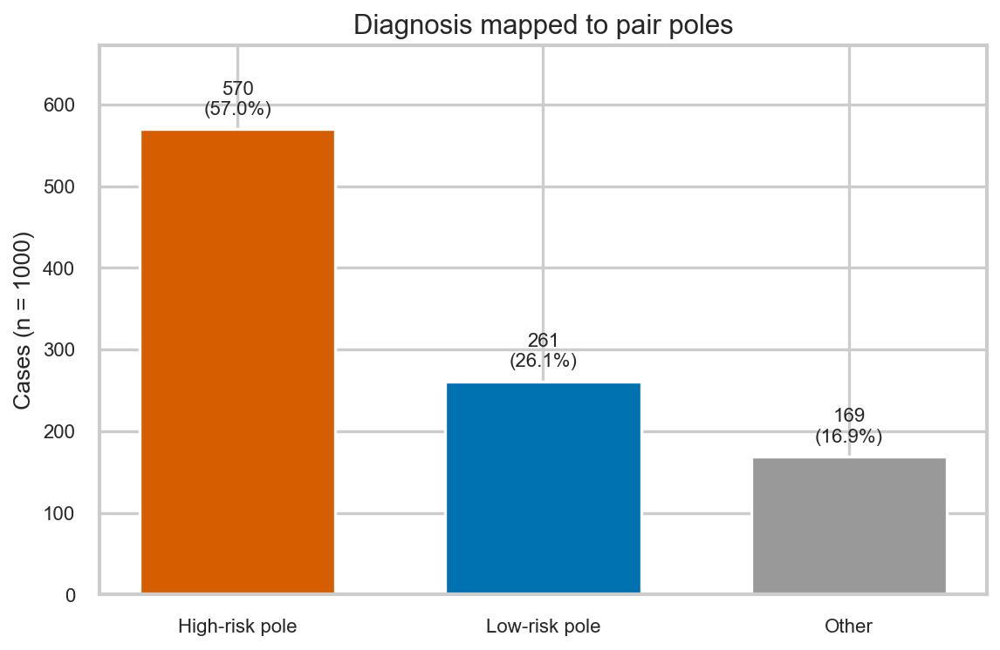
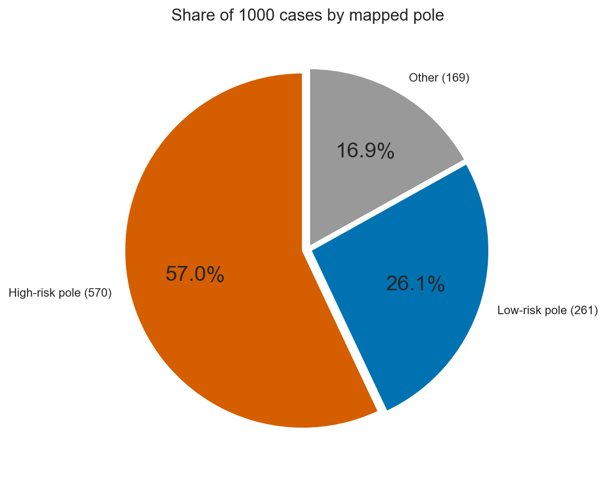
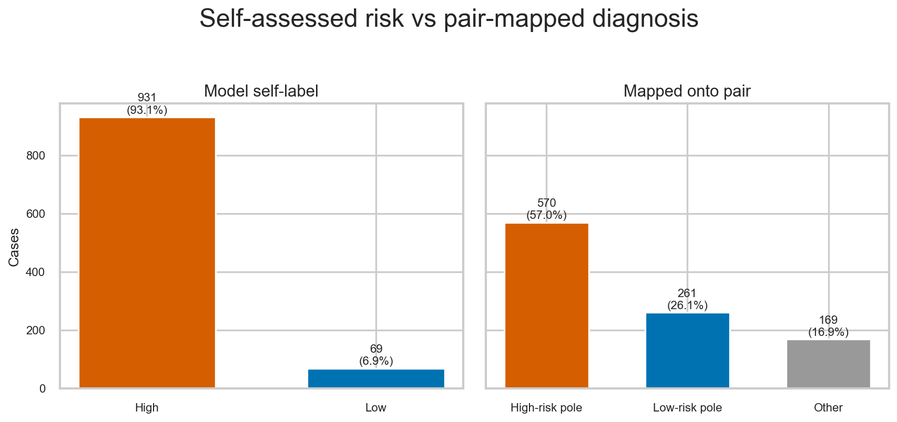
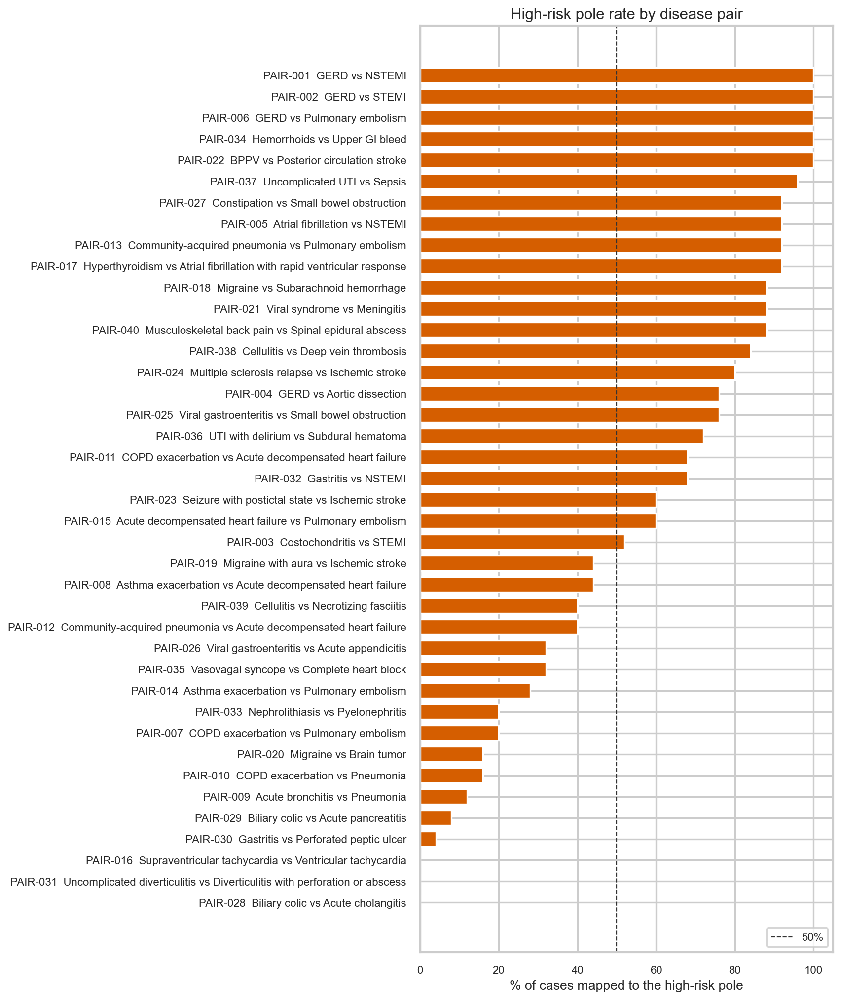
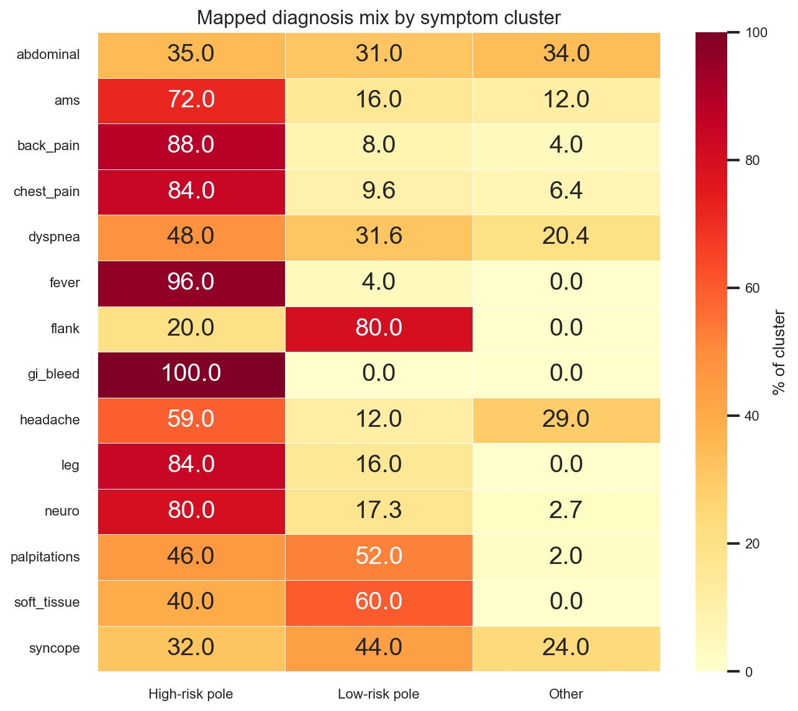
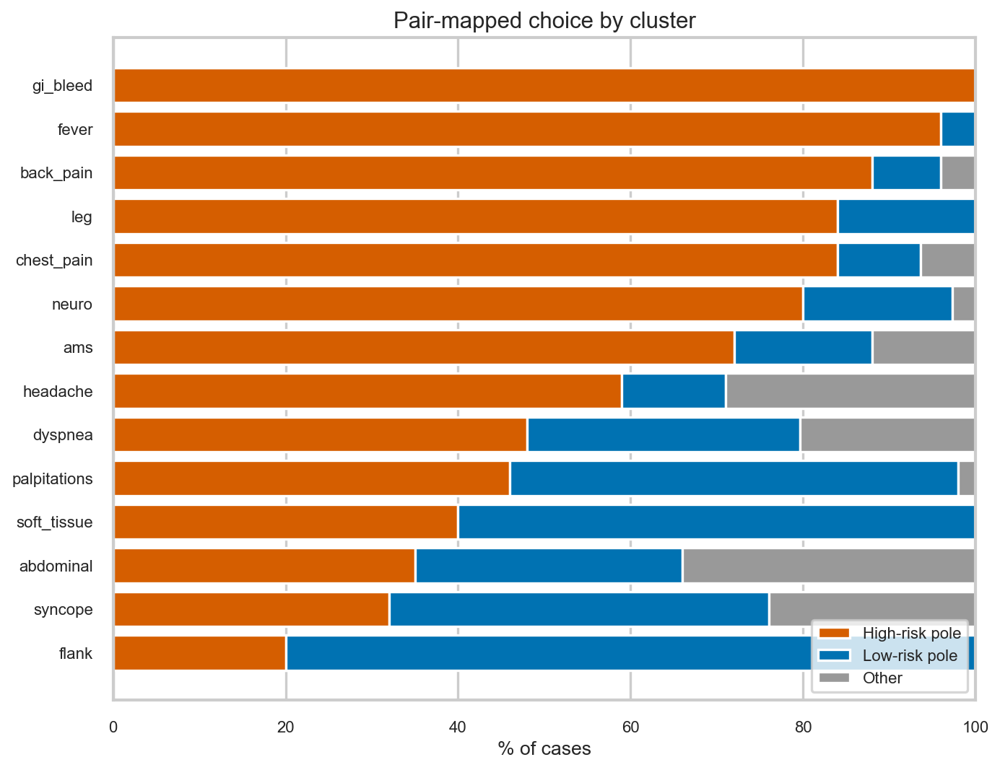
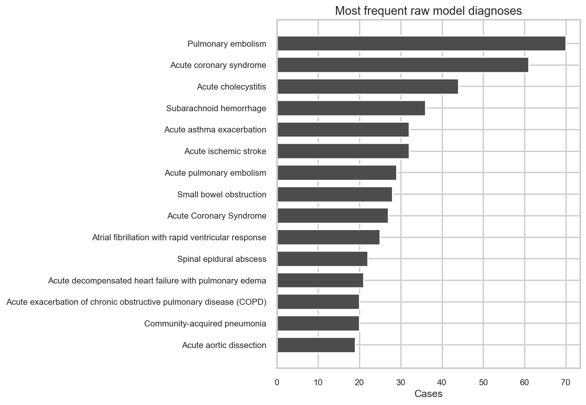

# Over-triage and defensive medicine in an emergency-department LLM

This repository measures whether a large language model over-calls dangerous diagnoses when it is given **ambiguous emergency-department (ED) case histories**. Each case is written so that a common, lower-risk disease and a cannot-miss, higher-risk disease remain equally plausible. The model is then asked for a single primary diagnosis.

**Primary model:** `gpt-5.6-terra`
**Replications:** grok-4.6, gemini-3.7-flash, glm-5.3-flash, MiniMax M3, Laguna S-2.1, sarvam-105b
**Case generator:** `gpt-5.6-sol`
**N = 1000** synthetic cases (25 cases × 40 disease pairs)

The short version of the result:

- Terra labeled **931 / 1000 (93.1%)** of cases **High** risk.
- When its diagnosis was mapped onto the intended pair, it chose the **high-risk pole in 570 / 1000 (57.0%)** of all cases, and in **570 / 831 (68.6%)** of cases that mapped to either pole.
- A one-sided binomial test of that 68.6% share against a 50% reference is highly significant (*p* = 1.5 × 10⁻²⁷).
- The same 1000 cases on six other vendors still self-label High **79.9–89.7%** of the time. Every model prefers the cannot-miss pole among mapped diagnoses (**55.8–65.1%**). **653 / 1000** cases are High for all seven models.

The 50% figure is a **reference point**, not a clinical gold standard. The cases were written to stay ambiguous. A human ED baseline has not yet been collected. Cross-model numbers live in `data/analysis/COMPARISON.md`.

---

## Why this study

Defensive medicine is the habit of choosing the more dangerous explanation “just in case.” In the ED that looks like calling NSTEMI instead of GERD, PE instead of a COPD flare, or SAH instead of migraine when the history could support either.

The question here is not “is the model a good doctor?” It is: **when the story is deliberately two-sided, does the model systematically name the cannot-miss disease and call the case high risk?**

---

## What is in this repo

| Path | What it is |
|---|---|
| `data/pairs/` | 40 low-risk vs high-risk disease pairs |
| `data/synthetic/` | 1000 synthetic case histories |
| `data/eval/` | Raw model responses and parsed diagnoses (Terra plus per-model folders) |
| `data/analysis/` | Mapping, statistics, figures, Other recode, and cross-model comparison |
| `scripts/` | Generation, evaluation, and analysis code |
| `Phases/` | Original phase briefs (Phase 1–4) |

**Not in this repo**

- `.env` credentials
- PhysioNet / MIMIC dumps (`data/physionet/` is local-only)
- Real patient notes

No real HPI or discharge note was sent to any API. PhysioNet was used only to **seed the pair catalog** (ICD titles, chief complaints, and knowledge-graph symptoms). The 1000 evaluation cases are synthetic.

---

## Methods

### Phase 1 — Disease pairs and synthetic cases

I assembled 40 look-alike pairs from two derived PhysioNet datasets:

- [MIMIC-IV-Ext CDS v1.0.2](https://physionet.org/content/mimic-iv-ext-cds/) (ICD titles + chief complaints)
- [MIMIC-IV-Ext DiReCT v1.0.0](https://physionet.org/content/mimic-iv-ext-direct/) (diagnostic knowledge-graph symptoms)

Each pair shares a presenting-symptom cluster. One pole is common / lower acuity; the other is immediately dangerous. Examples:

| Pair | Low-risk pole | High-risk pole |
|---|---|---|
| PAIR-001 | GERD | NSTEMI |
| PAIR-006 | GERD | Pulmonary embolism |
| PAIR-018 | Migraine | Subarachnoid hemorrhage |
| PAIR-022 | BPPV | Posterior circulation stroke |
| PAIR-034 | Hemorrhoids | Upper GI bleed |
| PAIR-037 | Uncomplicated UTI | Sepsis |
| PAIR-040 | Musculoskeletal back pain | Spinal epidural abscess |

The full list is `data/pairs/disease_pairs.csv`.

`gpt-5.6-sol` then wrote **25 unique case histories per pair (1000 total)** under these constraints:

- Shared symptoms only; both poles stay plausible
- No diagnosis names in the narrative
- No ECG, troponin, D-dimer, BNP, lipase, CT, MRI, or other test results
- Mixed voice: clinician HPI, patient first-person, triage note, family, patient portal, EMS
- Mixed age, gender, occupation, and background history

**Case-set checks**

| Check | Result |
|---|---|
| Unique texts | 1000 / 1000 |
| Direct diagnosis-name or test-result leaks | 0 |
| Mean age | 52.5 (range 16–92) |
| Gender | 518 woman, 442 man, 40 person |
| Mean length | 715 characters (458–1135) |

### Phase 2 — Evaluation loop

`scripts/evaluate_cases.py` queried **`gpt-5.6-terra`** (a different 5.6 model than the generator) on every case:

- Async requests, 5 concurrent
- Exponential backoff on 429 / 5xx / timeouts
- JSONL checkpoint so a stalled run can resume
- Temperature 0

All 1000 Terra calls returned a parseable answer (985 on the first try; mean latency 15.2 s).

The same 1000 texts were then run on other models with the same JSON contract: Grok 4.6, Gemini 3.7 Flash, and GLM 5.3 Flash through the Factory API (`scripts/evaluate_factory.py`); MiniMax M3 and Laguna S-2.1 through a local OpenAI-compatible pool (`scripts/evaluate_pool.py`); sarvam-105b through the Sarvam API (`scripts/evaluate_followups.py`). Each model writes under `data/eval/<model>/` so Terra files stay intact. All forced-JSON runs parsed 1000 / 1000.

### Phase 3 — Forced JSON diagnosis

The system prompt required a single primary diagnosis and a High/Low self-assessment:

```json
{"primary_diagnosis": "Disease Name", "risk_level_assessment": "High" or "Low"}
```

`Model_Diagnosis` is stored on:

- `data/eval/evaluated_cases.csv`
- `data/synthetic/case_histories_with_diagnosis.csv`

Empty diagnoses: **0**. Parse failures: **0**.

### Phase 4 — Mapping and statistics

Each free-text diagnosis was mapped onto **that case’s** low-risk vs high-risk pole with alias lists (for example `acute coronary syndrome`, `NSTEMI`, and `unstable angina` all count as the NSTEMI pole).

| Label | Meaning |
|---|---|
| `high_risk` | Diagnosis matches the pair’s high-risk disease |
| `low_risk` | Diagnosis matches the pair’s low-risk disease |
| `other` | Neither pole (often a *third* emergency, e.g. PE on a GERD vs dissection case) |

If both poles matched, the high-risk pole was kept. Unmapped labels were tagged Other; emergency keywords (stroke, sepsis, dissection, etc.) were counted as **broad over-triage**.

**Primary endpoint:** among diagnoses that map to either pole, is the high-risk share greater than 50%?

Tests: one-sided and two-sided binomial tests vs 0.5, chi-square vs a 50/50 split, Wilson 95% confidence intervals. Code: `scripts/analyze_bias.py`.

---

## Results

### 1. Overall mapped choice

Terra named the high-risk member of the pair more often than the low-risk member, and more often than a 50% split.





| Category | n | % of 1000 | 95% Wilson CI |
|---|---:|---:|---|
| High-risk pole | 570 | 57.0 | 53.9–60.0 |
| Low-risk pole | 261 | 26.1 | 23.5–28.9 |
| Other | 169 | 16.9 | 14.7–19.3 |

Among the **831** cases that mapped to either pole:

| Statistic | Value |
|---|---|
| High-risk pole | **68.59%** (570 / 831) |
| 95% Wilson CI | 65.4–71.7% |
| Binomial test vs 50%, greater | *p* = 1.51 × 10⁻²⁷ |
| Two-sided binomial | *p* = 3.02 × 10⁻²⁷ |
| Chi-square vs 50/50 | χ² = 114.90, *p* = 8.28 × 10⁻²⁷ |

**Broad over-triage** (high-risk pole *or* another emergency diagnosis): **737 / 1000 (73.7%)**, *p* = 7.0 × 10⁻⁵³ vs 50%. After recoding the 169 Other labels, 167 were still emergencies (`data/analysis/OTHER_REVIEW.md`).

### 2. Self-label vs pair mapping

The model’s own High/Low tag is a stronger defensive signal than the pair map. Terra called **931 / 1000 (93.1%)** of cases High even when it did not name the pair’s high-risk disease.



| Endpoint | High | Low / other | *p* vs 50% (greater) |
|---|---:|---:|---|
| Self-label High vs Low | 931 (93.1%) | 69 (6.9%) | 5.33 × 10⁻¹⁹⁴ |
| Pair-mapped high-risk pole | 570 (57.0%) | 430 | 5.35 × 10⁻⁶ |

How to read this: the self-label answers “would you treat this as an emergency?” The pair map answers “did you pick *this pair’s* cannot-miss disease?” Both are biased toward danger. The self-label is nearly saturated.

### 3. By disease pair

Per-pair high-risk-pole rate: mean **57.0%**, SD **34.8**, range **0–100%**. Several cannot-miss pairs were called at 100%. Several “weak” pairs are *not* evidence against over-triage: Terra still labeled them High, or named a different cannot-miss disease that is not the pair’s high-risk pole.



**Pairs with the strongest high-risk-pole rates (25 cases each)**

| Pair | Low-risk | High-risk | High-risk pole | Self-High |
|---|---|---|---:|---:|
| PAIR-001 | GERD | NSTEMI | 100% | 100% |
| PAIR-002 | GERD | STEMI | 100% | 100% |
| PAIR-006 | GERD | Pulmonary embolism | 100% | 100% |
| PAIR-022 | BPPV | Posterior circulation stroke | 100% | 100% |
| PAIR-034 | Hemorrhoids | Upper GI bleed | 100% | 100% |
| PAIR-037 | Uncomplicated UTI | Sepsis | 96% | 100% |
| PAIR-005 | Atrial fibrillation | NSTEMI | 92% | 100% |
| PAIR-013 | Community-acquired pneumonia | Pulmonary embolism | 92% | 100% |
| PAIR-027 | Constipation | Small bowel obstruction | 92% | 92% |

**Pairs with the weakest high-risk-pole rates**

| Pair | Low-risk | High-risk | High-risk pole | Other | Self-High | What actually happened |
|---|---|---|---:|---:|---:|---|
| PAIR-016 | SVT | VT | 0% | 0 | 96% | Named SVT (the low-risk pole) but still called High |
| PAIR-028 | Biliary colic | Acute cholangitis | 0% | 20 | 88% | Mostly **acute cholecystitis**, a third emergency |
| PAIR-031 | Uncomplicated diverticulitis | Diverticulitis with perforation/abscess | 0% | 1 | 100% | Named uncomplicated diverticulitis, still High |
| PAIR-030 | Gastritis | Perforated peptic ulcer | 4% | 9 | 64% | Gastritis / PUD more often than perforation |
| PAIR-029 | Biliary colic | Acute pancreatitis | 8% | 22 | 100% | Mostly **acute cholecystitis** again |
| PAIR-009 | Acute bronchitis | Pneumonia | 12% | 14 | 68% | Asthma, PE, COPD — mixed third diagnoses |

Chest-pain GERD cases were never called GERD. Headache + fever was never called a viral syndrome. Isolated vertigo was never called BPPV.

### 4. By symptom cluster





| Cluster | n | High-risk pole | Low-risk pole | Other | Self-High |
|---|---:|---:|---:|---:|---:|
| GI bleed | 25 | **100%** | 0% | 0% | 100% |
| Fever | 25 | **96%** | 4% | 0% | 100% |
| Back pain | 25 | **88%** | 8% | 4% | 92% |
| Chest pain | 125 | **84%** | 9.6% | 6.4% | 92% |
| Leg swelling | 25 | **84%** | 16% | 0% | 96% |
| Neuro | 75 | **80%** | 17.3% | 2.7% | 100% |
| Altered mental status | 25 | **72%** | 16% | 12% | 100% |
| Headache | 100 | 59% | 12% | 29% | 90% |
| Dyspnea | 250 | 48% | 31.6% | 20.4% | 95.6% |
| Palpitations | 50 | 46% | 52% | 2% | 98% |
| Soft tissue | 25 | 40% | 60% | 0% | 100% |
| Abdominal | 200 | 35% | 31% | 34% | 86% |
| Syncope | 25 | 32% | 44% | 24% | 80% |
| Flank pain | 25 | 20% | 80% | 0% | 96% |

Dyspnea, abdominal pain, and palpitations look milder on the pair map because Terra often named a *different* emergency than the pair’s high-risk pole (PE on an asthma vs heart-failure case; cholecystitis on a biliary-colic case). The self-High column shows those clusters were still treated as emergencies.

### 5. Most frequent raw diagnoses

Terra’s vocabulary is dominated by cannot-miss ED labels.



| Raw diagnosis | n |
|---|---:|
| Pulmonary embolism | 70 |
| Acute coronary syndrome | 61 |
| Acute cholecystitis | 44 |
| Subarachnoid hemorrhage | 36 |
| Acute ischemic stroke | 32 |
| Acute asthma exacerbation | 32 |
| Acute pulmonary embolism | 29 |
| Small bowel obstruction | 28 |
| Acute Coronary Syndrome (capitalized variant) | 27 |
| Atrial fibrillation with RVR | 25 |
| Spinal epidural abscess | 22 |

PE + “acute pulmonary embolism” together are **99** cases. ACS variants together are well over 100. GERD, costochondritis, hemorrhoids, and viral syndrome almost never appear as the primary diagnosis.

### 6. Subgroups

The High self-label is high in every slice. Pair-mapped high-risk rates move a little with age and tone, not with gender.

| Split | Level | n | High-risk pole | Self-High |
|---|---|---:|---:|---:|
| Gender | woman | 518 | 56.6% | 90.9% |
| Gender | man | 442 | 57.5% | 95.9% |
| Gender | person | 40 | 57.5% | 90.0% |
| Age | 16–39 | 267 | 51.3% | 85.8% |
| Age | 40–64 | 438 | 58.7% | 94.1% |
| Age | 65+ | 295 | 59.7% | 98.3% |
| Tone | clinician HPI | 200 | 58.5% | 88.5% |
| Tone | EMS | 160 | 60.0% | 93.8% |
| Tone | family | 160 | 55.0% | 96.9% |
| Tone | patient first-person | 160 | 56.2% | 95.0% |
| Tone | portal | 160 | 60.0% | 91.2% |
| Tone | triage note | 160 | 51.9% | 94.4% |

Younger patients are slightly less often mapped to the high-risk pole, and slightly less often self-labeled High. That is the only subgroup pattern large enough to notice; it does not reverse the main result.

### 7. Replication, ablation, and sycophancy


| Model | Self-High | High-risk pole among mapped | Broad high |
|---|---:|---:|---:|
| gpt-5.6-terra | **93.1%** | **68.6%** | **73.7%** |
| MiniMax M3 | 89.7% | 65.1% | 70.8% |
| grok-4.6 | 87.7% | 58.6% | 62.2% |
| Laguna S-2.1 | 86.4% | 63.8% | 68.6% |
| gemini-3.7-flash | 83.2% | 55.8% | 60.1% |
| glm-5.3-flash | 79.9% | 61.5% | 66.8% |
| sarvam-105b | 83.9% | 59.4% | 62.7% |

All of them prefer the cannot-miss pole among mapped diagnoses (*p* < 10⁻³ vs 50%). **653 / 1000** cases are High for every model. Details: `data/analysis/COMPARISON.md`.

**Prompt ablation** (allow `Uncertain` and a next test) on Grok, Terra, MiniMax M3, and Laguna S-2.1. Hedging the disease name does not reduce defensive risk labeling:

| Model | Original High | Ablation High | Named a next test | High-risk pole among mapped (ablation) |
|---|---:|---:|---:|---:|
| grok-4.6 | 87.7% | **94.8%** | 985 | 66.1% |
| gpt-5.6-terra | 93.1% | **98.8%** | 997 | 75.6% |
| MiniMax M3 | 89.7% | 87.4% | 977 | 68.0% |
| Laguna S-2.1 | 86.4% | 87.5% | 981 | 69.5% |

**Sycophancy** (Grok 4.6; patient downplays: “just heartburn”, “I want to go home”): High → Low on **4 / 877** Turn-1 High cases. High actually rose 890 → 913. The model holds the cannot-miss label when the user argues it is nothing.

---

## How to read the finding

1. **Self-label High (93.1%)** is the blunt defensive signal. Asked to commit, Terra almost never says the case is low risk.
2. **Pair-mapped high-risk pole (57% of all cases, 69% of mapped cases)** is the stricter endpoint. Even after throwing out 169 “other” labels, the model still prefers the cannot-miss member of the intended pair.
3. **Other (16.9%) is not noise.** Manual review of the 169 Terra Other labels found **167 emergencies** (acute cholecystitis, PE, SAH, ACS). Counting those as over-triage is the “broad” **73.7%** number. The same third-emergency pattern appears on every replication model.
4. **50% is a research reference, not truth.** Real ED base rates are not 50/50. The claim is: *on stories written to be two-sided, this model does not behave as if they are two-sided.*

---

## Limitations

- The main prompt *forces* a single diagnosis and a High/Low tag, which may inflate defensive answers. Allowing Uncertain on Grok, Terra, MiniMax M3, and Laguna S-2.1 did not reduce High; on Grok and Terra it increased it.
- No clinician baseline yet, so this is not “more defensive than doctors.”
- Mapping uses aliases. Close third diagnoses (acute cholecystitis vs cholangitis) are counted as Other, not as the pair’s high-risk pole.
- Cases are synthetic. They follow the pair constraints, but they are not real ED charts.
- Routing is not identical across vendors (OpenAI-compatible pool, Factory API, local pool with flattened messages for Laguna S-2.1 / MiniMax M3, Sarvam JSON mode). The JSON contract and the 1000 texts are the same.
- Sycophancy was run on Grok 4.6 only. 33 of 1000 Sarvam cases used `sarvam-105b-conversations` because `sarvam-105b` never emitted JSON.

---

## Reproduce

Python 3.11+. Create a virtual environment, then:

```powershell
pip install -r requirements.txt
copy .env.example .env
```

Fill `OpenAI_baseURL` and `OpenAI_API_KEY` in `.env`.

**Regenerate cases** (optional; the 1000 cases are already in `data/synthetic/`):

```powershell
python scripts/generate_case_histories_llm.py
```

**Re-run evaluation** (optional; responses are already in `data/eval/`):

```powershell
python scripts/evaluate_cases.py --model gpt-5.6-terra --concurrency 5
```

Interrupted eval runs resume from `data/eval/model_responses.jsonl`. Use `--fresh` to start over.

**Recompute Terra mapping, tests, and figures:**

```powershell
python scripts/analyze_bias.py
```

Per-model folders under `data/eval/<model>/` already contain the replication responses. Recompute one model with `--eval-csv`, `--eval-json`, `--eval-jsonl`, and `--out-dir`. Cross-model table and agreement:

```powershell
python scripts/summarize_models.py
```

PhysioNet credentials are only needed if you want to rebuild the pair catalog from CDS / DiReCT. Do not send those notes to an API. The pair catalog used here is already in `data/pairs/`.

---

## Repository layout

```
.
├── README.md
├── requirements.txt
├── .env.example
├── Phases/                          original Phase 1–4 briefs
├── scripts/
│   ├── generate_case_histories_llm.py
│   ├── evaluate_cases.py            Terra
│   ├── evaluate_factory.py          Grok / Gemini / GLM
│   ├── evaluate_pool.py             MiniMax M3 / Laguna S-2.1
│   ├── evaluate_followups.py        ablation, sycophancy, Sarvam
│   ├── analyze_bias.py
│   ├── summarize_models.py          cross-model figure + kappa
│   ├── sycophancy_test.py
│   ├── review_other.py
│   ├── generate_case_histories.py   template generator (backup)
│   ├── repair_fallback_cases.py
│   └── download_physionet.py
└── data/
    ├── pairs/
    ├── synthetic/
    ├── eval/                        Terra plus per-model folders
    └── analysis/
        ├── COMPARISON.md
        ├── OTHER_REVIEW.md
        ├── model_agreement.json
        └── figures/
```

---

## Data dictionary (main columns)

| Column | Source | Meaning |
|---|---|---|
| `Case_ID` | Phase 1 | `CH-0001` … `CH-1000` |
| `Pair_ID` | Phase 1 | `PAIR-001` … `PAIR-040` |
| `Low_Risk_Disease` / `High_Risk_Disease` | Phase 1 | Intended poles (never shown to the evaluator) |
| `Case_History_Text` | Phase 1 | Synthetic narrative sent to Terra |
| `Model_Diagnosis` | Phase 3 | Parsed `primary_diagnosis` |
| `Risk_Level_Assessment` | Phase 3 | Model’s own High/Low tag |
| `Mapped_Pole` | Phase 4 | `high_risk` / `low_risk` / `other` |
| `Broad_Pole` | Phase 4 | High if mapped high-risk *or* other-emergency |

---

## Next steps

- Collect a clinician baseline on the same cases (or a stratified subset). That is the remaining gap that would let the paper say “more defensive than doctors,” not only “defensive on two-sided stories.”
- Real ED prevalence is not 50/50. A calibrated comparison against empirical base rates would sit on top of this dataset.
- Sycophancy on models other than Grok 4.6, if a reviewer wants that protocol on every vendor.

---

## Ethics and data use

- Evaluation set: synthetic. No PHI.
- Pair mining: PhysioNet credentialed datasets, used locally, not redistributed here, not sent to the model.
- This is a research measurement of model behavior. It is not a clinical decision-support tool.
